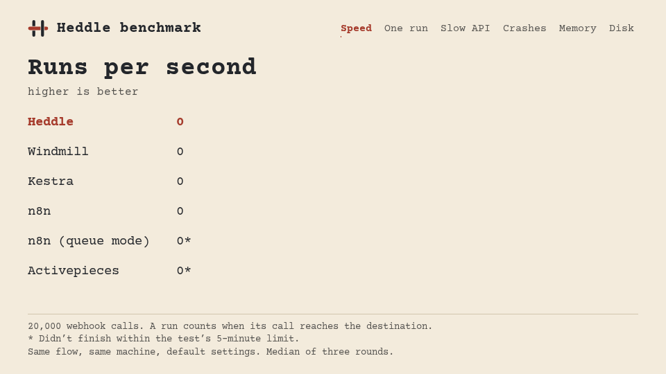

<p align="center">
  <picture>
    <source media="(prefers-color-scheme: dark)" srcset="logo-dark.svg" />
    
  </picture>
</p>

<h1 align="center">Heddle</h1>

<p align="center">
  <strong>Automation you actually own.</strong><br />
  Open-source workflow automation on the BEAM, under the MIT license.
</p>

<p align="center">
  <a href="https://heddlehq.github.io/website/">Website</a> ·
  <a href="https://github.com/heddlehq/Heddle/blob/main/guides/installation.md">Install guide</a> ·
  <a href="https://github.com/heddlehq/roadmap">Roadmap</a> ·
  <a href="https://github.com/orgs/heddlehq/projects/2">Project board</a> ·
  <a href="https://discord.gg/7zjnpna239">Discord</a>
</p>

---

Connect your tools and automate the work in between. Draw the flow on a canvas, or describe what you need and let the AI build it. Every run is a lightweight Erlang process, and the queue lives in Postgres, with no Redis in the way.

## Install

One line, nothing else to set up. It asks which AI provider to use and whether you also want Treadle, the terminal editor.

```bash
# macOS and Linux
curl -fsSL https://heddlehq.github.io/website/install.sh | sh
```

```powershell
# Windows (PowerShell)
irm https://heddlehq.github.io/website/install.ps1 | iex
```

Then `heddle status`, `heddle logs -f`, `heddle doctor` and `heddle update`. For servers, see the [installation guide](https://github.com/heddlehq/Heddle/blob/main/guides/installation.md).

## Benchmark

Same flow, same machine, default settings, against Windmill, Kestra, n8n and Activepieces.

<p align="center">
  
</p>

We wrote the test and Heddle is in it, so it is all meant to be checked and rerun: [method and raw data](https://github.com/heddlehq/Heddle/tree/main/benchmark/compare).

## Repositories

| | |
| --- | --- |
| **[Heddle](https://github.com/heddlehq/Heddle)** | The platform: visual editor, workers, AI agent, MCP server and public API. Elixir and Phoenix. |
| **[Treadle](https://github.com/heddlehq/Treadle)** | Build and run flows from the terminal. Go and Bubble Tea. |
| **[Bobbin](https://github.com/heddlehq/Bobbin)** | Elixir SDK for writing your own nodes and integrations. |
| **[roadmap](https://github.com/heddlehq/roadmap)** | Where Heddle is going, planned in public. |
| **[website](https://github.com/heddlehq/website)** | The landing page and the install scripts. |

## Contributing

Heddle is built in public. Start with the [contributing guide](https://github.com/heddlehq/Heddle/blob/main/CONTRIBUTING.md), pick something from the [project board](https://github.com/orgs/heddlehq/projects/2), or come say hi on [Discord](https://discord.gg/7zjnpna239).
